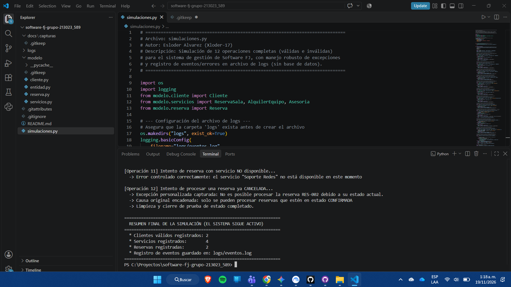
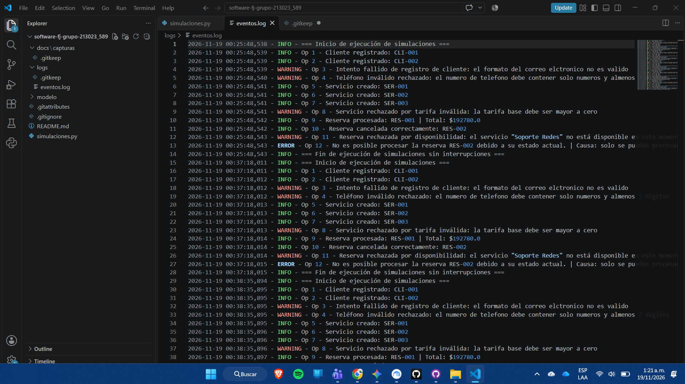
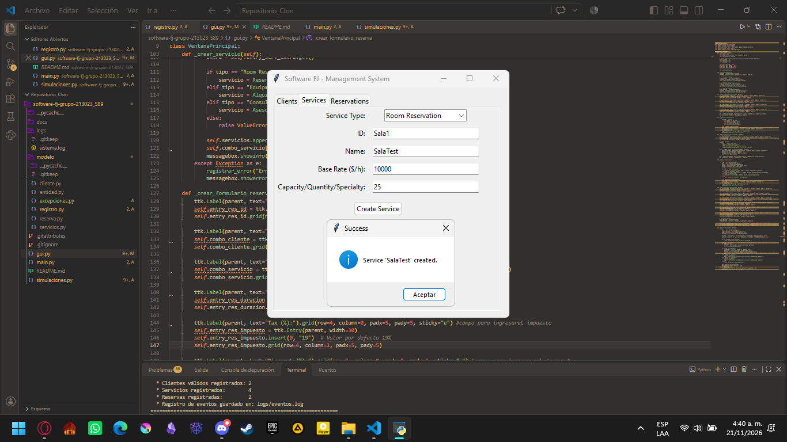
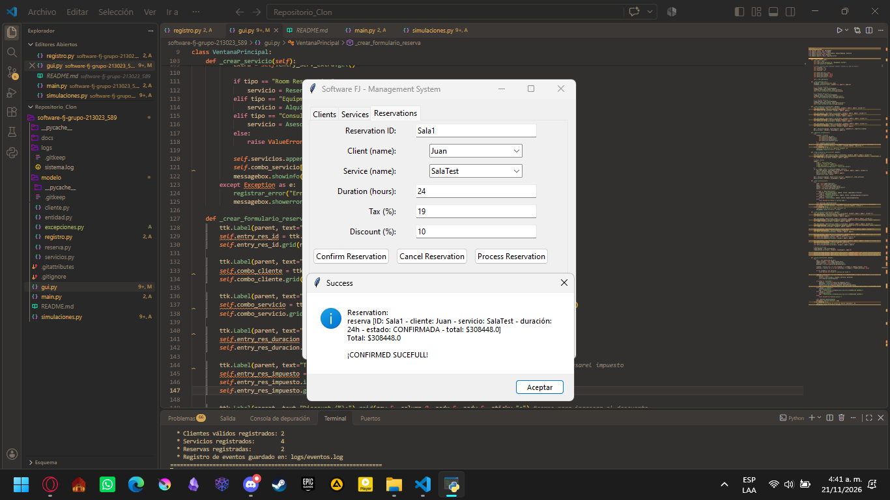

**Fase 4 - Componente práctico - Prácticas simuladas**  
Curso: Programación (213023) - UNAD
---

## Descripción del proyecto
Aplicación desarrollada en Python bajo el paradigma de Programación Orientada a Objetos (POO) con manejo avanzado de excepciones, validaciones estrictas y registro de eventos en archivos (sin base de datos).

## Integrantes
- Esloder Alvarez QUINCHIA (`Xloder-17`)
- JEFFERSON ANDREY AYA BARBOSA (`MAnieggo`)
- LUIS EDUARDO CALVO MORENO (`Lucal84`)

## Estructura del proyecto
- `main.py`: Punto de entrada principal; ejecuta las simulaciones automáticas y lanza la interfaz gráfica.
- `gui.py`: Interfaz gráfica en `Tkinter` dividida en pestañas para el registro de clientes, creación de servicios y gestión de estados de reservas.
- `simulaciones.py`: Script con 12 operaciones de prueba (válidas e inválidas), bloques `try/except/else/finally` y encadenamiento de excepciones (`raise ... from ...`).
- `modelo/`:
  - `entidad.py`: Clase abstracta base (`ABC`) con identificador validado y método polimórfico `describir()`.
  - `cliente.py`: Gestión y validación de datos de clientes.
  - `servicios.py`: Jerarquía de servicios (`Servicio`, `ReservaSala`, `AlquilerEquipo`, `Asesoria`) con cálculo polimórfico de tarifas.
  - `reserva.py`: Lógica de reservas, cálculo de subtotales, impuestos, descuentos y control de transiciones de estado (`PENDIENTE`, `CONFIRMADA`, `PROCESADA`, `CANCELADA`).
  - `excepciones.py`: Jerarquía de excepciones personalizadas del sistema (`SistemaError`, `ValidacionError`, `ServicioNoDisponibleError`, `OperacionNoPermitidaError`, entre otras).
  - `registro.py`: Configuración del logger centralizado rotativo (`logs/sistema.log`) y captura global de excepciones no manejadas.
- `logs/sistema.log`: Archivo unificado donde se registran las operaciones exitosas, advertencias y trazas de error.
- `docs/capturas/`: Evidencias visuales de ejecución y pruebas.

## Ejecución
1. Clonar el repositorio:
   `git clone https://github.com/Lucal84/software-fj-grupo-213023_589.git`
2. Ejecutar las simulaciones desde la terminal:
   `python simulaciones.py`
3. *(Para el sistema interactivo completo, ejecutar `python main.py` una vez integrado).*

## Evidencias de ejecución

#### Ejecución de simulaciones (12 operaciones)

#### Registro de eventos y errores (`logs/eventos.log`)

#### Registro de un usuario

#### Registro de un servicio

#### Confirmación/Cancelación/Procesamiento de una reserva

---
> **Declaración sobre el uso de IA**
Durante el desarrollo de este proyecto se utilizaron herramientas de inteligencia artificial como Gemini con el fin exclusivo de aportar apoyo conceptual para aclarar dudas teóricas y comprender el funcionamiento de los programas y/o herramientas usadas en el desarrollo, tales como GitHub y Visual Studio Code, al igual que como apoyo con problemas tecnicos relacionadaos con los mismos. Toda la lógica, implementación y pruebas fueron desarrolladas y validadas manualmente por los integrantes del equipo
